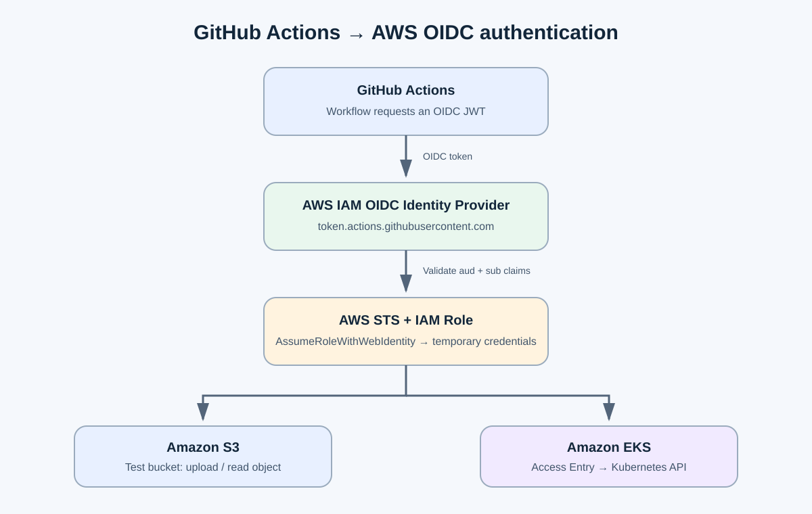
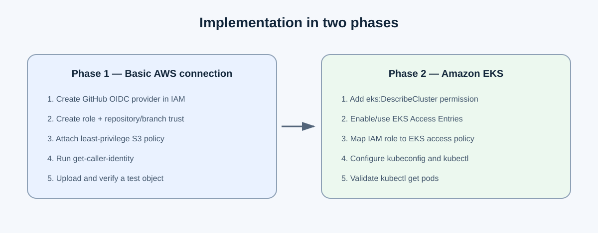
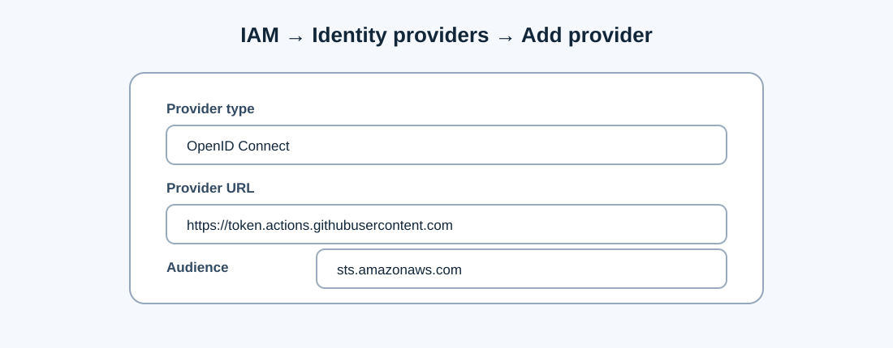
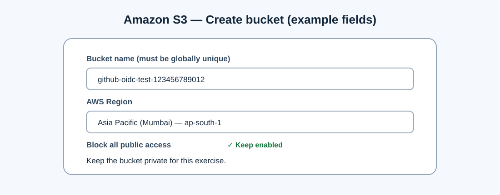
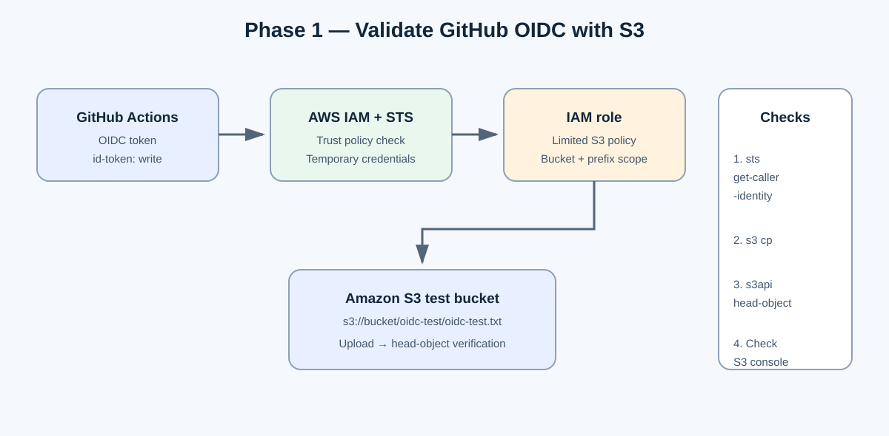
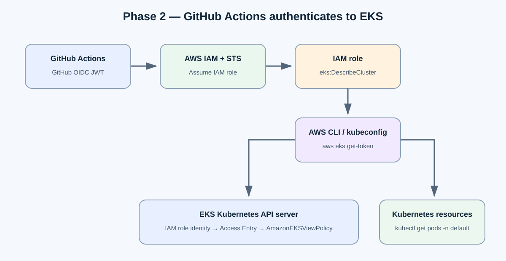
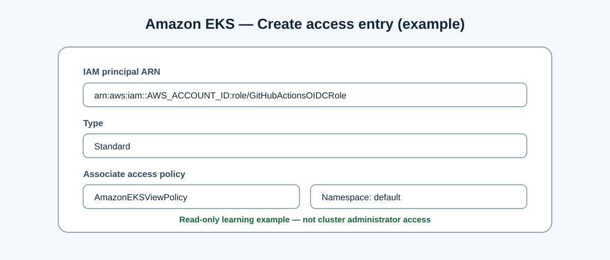
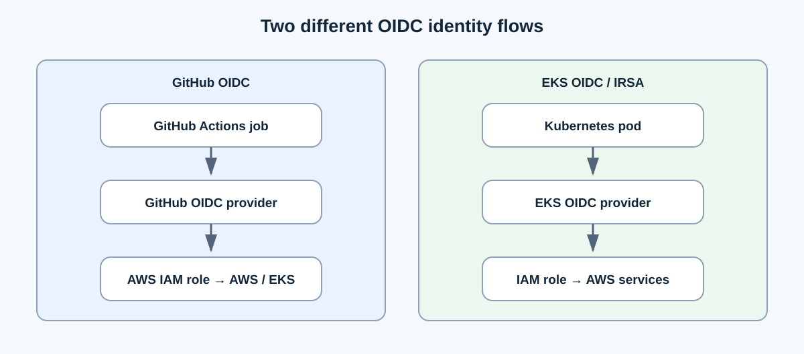

# Connect GitHub Actions to AWS using OIDC (S3 first, then Amazon EKS)

A practical, step-by-step guide to connect **GitHub Actions to AWS using OpenID Connect (OIDC)** without storing long-lived AWS access keys in GitHub Secrets.

> The diagrams in `assets/` are original explanatory illustrations of the settings and architecture. They are not screenshots of a live AWS account; AWS Console labels and layouts can change over time.

We will implement this in two phases:

1. **Phase 1 – Amazon S3:** Configure GitHub OIDC in AWS IAM, create a role, grant limited S3 permissions, and prove the connection by uploading a file.
2. **Phase 2 – Amazon EKS:** Reuse the GitHub OIDC provider and IAM role, register the role with EKS Access Entries, and run `kubectl` from GitHub Actions.

> **Important distinction:** GitHub OIDC and EKS OIDC/IRSA are two different identity flows. This guide uses GitHub OIDC for the GitHub Actions runner. It does not require IRSA to let the runner access the EKS API. IRSA is used when an application running inside a Kubernetes pod needs AWS permissions.

---

## Table of contents

- [1. What is OIDC and why use it?](#1-what-is-oidc-and-why-use-it)
- [2. Overall implementation plan](#2-overall-implementation-plan)
- [3. Prerequisites and example values](#3-prerequisites-and-example-values)
- [Phase 1 – GitHub Actions to Amazon S3](#phase-1--github-actions-to-amazon-s3)
  - [4. Create the GitHub OIDC identity provider in AWS](#4-create-the-github-oidc-identity-provider-in-aws)
  - [5. Get the identifiers needed for the trust policy](#5-get-the-identifiers-needed-for-the-trust-policy)
  - [6. Create the IAM role and trust policy](#6-create-the-iam-role-and-trust-policy)
  - [7. Create the S3 test bucket](#7-create-the-s3-test-bucket)
  - [8. Add limited S3 permissions to the role](#8-add-limited-s3-permissions-to-the-role)
  - [9. Add the GitHub Actions S3 workflow](#9-add-the-github-actions-s3-workflow)
  - [10. Run and validate the S3 workflow](#10-run-and-validate-the-s3-workflow)
- [Phase 2 – GitHub Actions to Amazon EKS](#phase-2--github-actions-to-amazon-eks)
  - [11. Understand the EKS authentication flow](#11-understand-the-eks-authentication-flow)
  - [12. Add EKS DescribeCluster permission](#12-add-eks-describecluster-permission)
  - [13. Enable and configure EKS Access Entries](#13-enable-and-configure-eks-access-entries)
  - [14. Create the EKS access entry and associate a policy](#14-create-the-eks-access-entry-and-associate-a-policy)
  - [15. Add the GitHub Actions EKS workflow](#15-add-the-github-actions-eks-workflow)
  - [16. Run and validate the EKS workflow](#16-run-and-validate-the-eks-workflow)
- [17. GitHub OIDC vs. EKS OIDC / IRSA](#17-github-oidc-vs-eks-oidc--irsa)
- [18. Common errors and troubleshooting](#18-common-errors-and-troubleshooting)
- [19. Final architecture](#19-final-architecture)
- [20. Recommended next learning steps](#20-recommended-next-learning-steps)
- [21. Security checklist](#21-security-checklist)
- [22. Official documentation](#22-official-documentation)

---

## 1. What is OIDC and why use it?

Traditionally, a GitHub Actions workflow might authenticate to AWS by saving these long-lived credentials in GitHub Secrets:

- `AWS_ACCESS_KEY_ID`
- `AWS_SECRET_ACCESS_KEY`

That approach requires you to create and rotate IAM user access keys. If a key is exposed, someone could use it until it is disabled or expires through another control.

With **OpenID Connect (OIDC)**, GitHub Actions requests a short-lived identity token from GitHub. AWS validates the token and, if the repository/branch matches the IAM role's trust policy, AWS Security Token Service (STS) issues temporary credentials for that role.

You do **not** need to save an AWS access key or secret in GitHub Secrets for this flow.

### How GitHub Actions communicates with AWS



The flow is:

1. A GitHub Actions job requests a GitHub OIDC token (JWT).
2. GitHub identifies the workflow context, such as repository and branch, in the token claims.
3. AWS IAM validates the token using the GitHub OIDC identity provider configuration.
4. AWS checks the role's trust policy, including the audience (`aud`) and subject (`sub`) claims.
5. The workflow calls AWS STS `AssumeRoleWithWebIdentity` and receives temporary AWS credentials.
6. The workflow uses those credentials to access only the AWS resources allowed by the IAM role's permission policies.

**Remember these two separate IAM concepts:**

| Policy / configuration | What it controls | In this guide |
|---|---|---|
| IAM role trust policy | Who can assume the IAM role? | The specified GitHub repository and branch |
| IAM role permission policy | What can the assumed role do in AWS? | List/upload/read within the test S3 bucket, then describe one EKS cluster |

The trust policy does not grant S3 or EKS access by itself. The permission policy does not decide which GitHub repository can assume the role. Both are required.

---

## 2. Overall implementation plan



### Phase 1 – Basic AWS connection using S3

1. Create the GitHub OIDC identity provider in AWS IAM.
2. Create an IAM role with a trust policy restricted to your repository and branch.
3. Create an S3 test bucket.
4. Give the IAM role limited permissions for that bucket and a test prefix.
5. Configure a GitHub Actions workflow with `id-token: write`.
6. Validate the assumed role with `aws sts get-caller-identity`.
7. Upload a test file and verify it in S3.

### Phase 2 – EKS integration

1. Add `eks:DescribeCluster` permission to the IAM role.
2. Ensure the EKS cluster supports Access Entries.
3. Create an EKS Access Entry for the GitHub IAM role.
4. Associate a limited EKS access policy, initially `AmazonEKSViewPolicy` for the `default` namespace.
5. Configure `kubectl` and the EKS kubeconfig in GitHub Actions.
6. Validate access with `kubectl get pods -n default`.

---

## 3. Prerequisites and example values

Before starting, you need:

| Requirement | Purpose |
|---|---|
| AWS account | Create the IAM identity provider, IAM role, S3 bucket, and EKS access configuration |
| AWS IAM permissions | Create/manage IAM OIDC providers and roles, create S3 bucket/policies, and manage EKS access configuration |
| GitHub account | Run GitHub Actions |
| GitHub repository | Store the workflow YAML files |
| AWS region | Example: `ap-south-1` (Asia Pacific – Mumbai) |
| Existing EKS cluster | Required only for Phase 2; this guide does not create an EKS cluster |
| AWS CLI (optional for setup) | Useful for commands that configure or inspect AWS resources |
| GitHub CLI (optional) | Useful for retrieving GitHub owner and repository IDs |

### Example values used in this guide

Replace these example values with your own values everywhere they appear.

| Configuration | Example |
|---|---|
| GitHub owner / organization | `your-github-username` |
| GitHub repository | `aws-oidc-demo` |
| GitHub branch | `main` |
| AWS region | `ap-south-1` |
| IAM role | `GitHubActionsOIDCRole` |
| S3 bucket | `github-oidc-test-123456789012` |
| EKS cluster | `YOUR_EKS_CLUSTER` |
| S3 test object key | `oidc-test/oidc-test.txt` |

**S3 bucket names must be globally unique.** If the example name is already taken, add a random suffix. Keep S3 Block Public Access enabled for this exercise.

### Get your AWS account ID

With an AWS CLI profile that is already authenticated:

```bash
aws sts get-caller-identity --query Account --output text
```

The result is your 12-digit AWS account ID. Replace `AWS_ACCOUNT_ID` in the examples with this value.

---

# Phase 1 – GitHub Actions to Amazon S3

## 4. Create the GitHub OIDC identity provider in AWS

An **OIDC identity provider** tells AWS that GitHub is a trusted token issuer. You configure this provider once per AWS account for GitHub Actions, then IAM roles can trust it.

### AWS Console steps

1. Sign in to the AWS Management Console.
2. Search for and open **IAM**.
3. In the left navigation pane, choose **Identity providers**.
4. Choose **Add provider**.
5. Select **OpenID Connect** as the provider type.
6. Enter these values:

   | Field | Value |
   |---|---|
   | Provider URL | `https://token.actions.githubusercontent.com` |
   | Audience | `sts.amazonaws.com` |

7. Choose **Add provider**.



### Expected result

You should see an identity provider with this URL:

```text
https://token.actions.githubusercontent.com
```

Its IAM provider ARN will look like:

```text
arn:aws:iam::AWS_ACCOUNT_ID:oidc-provider/token.actions.githubusercontent.com
```

Replace `AWS_ACCOUNT_ID` with your AWS account ID when using the ARN in the trust policy.

**Certificate/thumbprint note:** AWS IAM normally retrieves and uses the certificate chain for publicly trusted certificate authorities when creating an OIDC provider. A configured thumbprint is used as a fallback in certain situations, such as when AWS cannot retrieve the TLS certificate or when TLS 1.3 is required. You generally do not need to manually calculate a GitHub thumbprint for this standard setup. Follow the AWS IAM documentation if AWS reports a certificate/thumbprint issue.

---

## 5. Get the identifiers needed for the trust policy

The trust policy must match the `sub` (subject) claim issued by GitHub. **The exact format depends on the repository's OIDC subject-claim setting and when the repository was created.**

### Important GitHub change effective July 15, 2026

GitHub repositories created after **July 15, 2026** use immutable subject claims by default. The new subject contains both the owner ID and repository ID:

```text
repo:OWNER@OWNER_ID/REPOSITORY@REPOSITORY_ID:ref:refs/heads/BRANCH
```

Example:

```text
repo:octo-org@123456/octo-repo@456789:ref:refs/heads/main
```

Repositories created before July 15, 2026 keep the previous format unless immutable subject claims are enabled:

```text
repo:OWNER/REPOSITORY:ref:refs/heads/BRANCH
```

Example:

```text
repo:octo-org/octo-repo:ref:refs/heads/main
```

Repository renames/transfers after the rollout can also result in the immutable format. Do not guess which format applies: use the subject format actually issued for your repository.

### Retrieve owner and repository IDs with GitHub CLI

Install and authenticate GitHub CLI (`gh`) first, then run:

For a personal GitHub account:

```bash
# Get your personal account ID
gh api users/GITHUB_OWNER --jq .id

# Get the repository ID
gh api repos/GITHUB_OWNER/REPOSITORY --jq .id
```

For an organization:

```bash
# Get your organization ID
gh api orgs/GITHUB_ORG --jq .id

# Get the repository ID
gh api repos/GITHUB_ORG/REPOSITORY --jq .id
```

The returned IDs are numeric. Use the exact owner/repository names and IDs in the immutable subject string.

### Check your repository's subject-claim configuration

GitHub documents the OIDC claim formats and provides guidance for debugging OIDC claims. Your AWS trust policy's `sub` condition must exactly match the token subject for the workflow run.

For this guide, the workflow runs from the `main` branch and does not use a GitHub Environment. If you add a GitHub Environment (for example, `production`), the `sub` claim format changes to include the environment context. Update the AWS trust policy accordingly.

---

## 6. Create the IAM role and trust policy

The IAM role is the identity that GitHub Actions will assume. It has two important parts:

- **Trust policy:** allows a specific GitHub OIDC identity to assume the role.
- **Permission policy:** defines which AWS API operations the role can perform. We add the S3 permissions in the next section.

### AWS Console steps

1. Open **IAM → Roles**.
2. Choose **Create role**.
3. For the trusted entity type, select **Custom trust policy**.
4. Replace the example JSON with the trust policy for your repository.
5. Choose **Next** and continue through the role creation screens.
6. Name the role:

   ```text
   GitHubActionsOIDCRole
   ```

7. Create the role.

### Recommended trust policy for a repository using immutable subject claims

Use this format for a repository created after July 15, 2026, or one that has opted into immutable subject claims.

```json
{
  "Version": "2012-10-17",
  "Statement": [
    {
      "Effect": "Allow",
      "Principal": {
        "Federated": "arn:aws:iam::AWS_ACCOUNT_ID:oidc-provider/token.actions.githubusercontent.com"
      },
      "Action": "sts:AssumeRoleWithWebIdentity",
      "Condition": {
        "StringEquals": {
          "token.actions.githubusercontent.com:aud": "sts.amazonaws.com",
          "token.actions.githubusercontent.com:sub": "repo:GITHUB_OWNER@OWNER_ID/REPOSITORY@REPOSITORY_ID:ref:refs/heads/main"
        }
      }
    }
  ]
}
```

Replace:

- `AWS_ACCOUNT_ID` with your 12-digit AWS account ID.
- `GITHUB_OWNER` with your GitHub username or organization name.
- `OWNER_ID` with the numeric personal-account or organization ID.
- `REPOSITORY` with the repository name.
- `REPOSITORY_ID` with the numeric repository ID.

### Alternative trust policy for an older repository using the traditional subject claim

Use this format only if your repository still emits the traditional subject claim (for example, a repository created before July 15, 2026 that has not opted in to immutable claims).

```json
{
  "Version": "2012-10-17",
  "Statement": [
    {
      "Effect": "Allow",
      "Principal": {
        "Federated": "arn:aws:iam::AWS_ACCOUNT_ID:oidc-provider/token.actions.githubusercontent.com"
      },
      "Action": "sts:AssumeRoleWithWebIdentity",
      "Condition": {
        "StringEquals": {
          "token.actions.githubusercontent.com:aud": "sts.amazonaws.com",
          "token.actions.githubusercontent.com:sub": "repo:GITHUB_OWNER/REPOSITORY:ref:refs/heads/main"
        }
      }
    }
  ]
}
```

Replace `AWS_ACCOUNT_ID`, `GITHUB_OWNER`, and `REPOSITORY` with your own values.

### Understand the trust policy

| JSON field | Meaning |
|---|---|
| `Federated` | Identifies the GitHub OIDC provider in AWS IAM |
| `Action` | Allows the OIDC web-identity role-assumption operation |
| `aud` | Ensures the token is intended for AWS STS (`sts.amazonaws.com`) |
| `sub` | Restricts the trusted identity to the exact repository and branch |

**Security warning:** Do not remove the `sub` condition and do not use a broad wildcard that allows every GitHub repository to assume the role. Restrict the role to the exact repository and branch (or an explicitly controlled GitHub Environment) that needs access.

### What if my workflow uses a GitHub Environment?

When a job references an environment, GitHub's subject claim typically identifies the environment instead of the branch. For example, the subject can look like:

```text
repo:OWNER/REPOSITORY:environment:production
```

For immutable claims, the owner and repository IDs are also included. Configure the trust policy to match the actual subject claim. You should also protect the GitHub Environment with required reviewers and deployment branch restrictions where appropriate.

---

## 7. Create the S3 test bucket

We use Amazon S3 as the first AWS service because it lets us verify a real operation: GitHub Actions will upload a file and then check that the object exists.

### AWS Console steps

1. Open the AWS Management Console.
2. Search for **S3** and open it.
3. Choose **Create bucket**.
4. Enter a globally unique bucket name, for example:

   ```text
   github-oidc-test-123456789012
   ```

5. Select the same AWS region used in the GitHub workflow, for example `ap-south-1`.
6. Keep **Block all public access** enabled.
7. Leave other settings at their defaults for this test unless your organization requires different settings.
8. Choose **Create bucket**.



### Expected result

You should see your new S3 bucket in the bucket list. Keep the bucket private. The workflow only needs permission to access the test prefix inside this bucket.

---

## 8. Add limited S3 permissions to the role

Creating a role and configuring its trust policy does **not** automatically give it permission to use S3. Now attach an inline permission policy to the role.

### AWS Console steps

1. Open **IAM → Roles**.
2. Select `GitHubActionsOIDCRole`.
3. Choose **Add permissions → Create inline policy**.
4. Select the **JSON** editor.
5. Paste the policy below.
6. Replace the bucket name with your actual bucket name.
7. Choose **Next** and name the policy:

   ```text
   GitHubActionsS3TestPolicy
   ```

8. Create the policy.

### S3 permission policy

```json
{
  "Version": "2012-10-17",
  "Statement": [
    {
      "Sid": "ListTestBucket",
      "Effect": "Allow",
      "Action": [
        "s3:ListBucket"
      ],
      "Resource": "arn:aws:s3:::github-oidc-test-123456789012"
    },
    {
      "Sid": "UploadAndReadTestObjects",
      "Effect": "Allow",
      "Action": [
        "s3:PutObject",
        "s3:GetObject"
      ],
      "Resource": "arn:aws:s3:::github-oidc-test-123456789012/oidc-test/*"
    }
  ]
}
```

This policy allows:

- Listing the specified S3 bucket.
- Uploading objects under `oidc-test/` in that bucket.
- Reading objects under `oidc-test/` in that bucket.

It does not grant access to every S3 bucket in the account. For this workflow, the role does not need S3 delete permissions.

---

## 9. Add the GitHub Actions S3 workflow

Now configure the GitHub repository.

### Create the workflow folder structure

In your repository, create:

```text
aws-oidc-demo/
│
└── .github/
    └── workflows/
        └── aws-oidc-test.yml
```

Create the file `.github/workflows/aws-oidc-test.yml` with the following content.

### `aws-oidc-test.yml`

```yaml
name: GitHub Actions AWS OIDC Test

on:
  push:
    branches:
      - main
  workflow_dispatch:

permissions:
  id-token: write
  contents: read

env:
  AWS_REGION: ap-south-1
  S3_BUCKET: github-oidc-test-123456789012

jobs:
  AWS-OIDC-Test:
    name: Connect GitHub to AWS
    runs-on: ubuntu-latest

    steps:
      # Step 1: Configure AWS credentials using OIDC
      - name: Configure AWS Credentials
        uses: aws-actions/configure-aws-credentials@v6.3.0
        with:
          role-to-assume: arn:aws:iam::AWS_ACCOUNT_ID:role/GitHubActionsOIDCRole
          aws-region: ${{ env.AWS_REGION }}
          role-session-name: GitHubActionsSession

      # Step 2: Verify AWS authentication
      - name: Verify AWS Identity
        run: |
          aws sts get-caller-identity

      # Step 3: Create a sample file
      - name: Create Test File
        run: |
          echo "Hello AWS OIDC from GitHub Actions" > oidc-test.txt

      # Step 4: Verify S3 access and upload the file
      - name: Upload File to S3
        run: |
          aws s3 ls "s3://${S3_BUCKET}/"

          aws s3 cp oidc-test.txt \
            "s3://${S3_BUCKET}/oidc-test/oidc-test.txt"

      # Step 5: Verify the uploaded object
      - name: Verify S3 Upload
        run: |
          aws s3api head-object \
            --bucket "${S3_BUCKET}" \
            --key "oidc-test/oidc-test.txt"
```

Replace:

- `AWS_ACCOUNT_ID` with your 12-digit AWS account ID.
- `S3_BUCKET` with your actual bucket name.
- `AWS_REGION` with the region where the bucket was created.

### Understand the important workflow lines

#### A. `id-token: write`

```yaml
permissions:
  id-token: write
  contents: read
```

`id-token: write` allows the GitHub Actions job to request an OIDC token. It does **not** give the job permission to modify AWS resources. AWS IAM still decides what the assumed role can do.

`contents: read` is included as a commonly useful minimal permission when a workflow needs to read repository contents. This example does not need a checkout step, but keeping the permission is fine for a workflow that may later add one.

#### B. AWS credentials action

```yaml
uses: aws-actions/configure-aws-credentials@v6.3.0
```

This action requests a GitHub OIDC token and exchanges it with AWS STS for temporary credentials by assuming the configured IAM role.

#### C. Role ARN

```yaml
role-to-assume: arn:aws:iam::AWS_ACCOUNT_ID:role/GitHubActionsOIDCRole
```

This identifies the IAM role created in [Section 6](#6-create-the-iam-role-and-trust-policy).

#### D. No static AWS secrets

You do not need to create these GitHub repository secrets for this OIDC workflow:

```text
AWS_ACCESS_KEY_ID
AWS_SECRET_ACCESS_KEY
```

That is the main benefit of using OIDC instead of long-lived access keys.

> **Action version note:** This README uses the action versions shown in the examples (`aws-actions/configure-aws-credentials@v6.3.0` and, later, `azure/setup-kubectl@v5.2.0`). Check the official release pages before adopting the guide in a future project. For high-assurance production workflows, consider pinning third-party actions to verified full commit SHAs and maintaining an update process.

---

## 10. Run and validate the S3 workflow

1. Commit and push `.github/workflows/aws-oidc-test.yml` to the `main` branch.
2. Alternatively, open the GitHub repository and select **Actions**.
3. Choose **GitHub Actions AWS OIDC Test**.
4. Select **Run workflow** and choose the `main` branch.
5. Open the workflow run and review each step.



### Validation 1 – Verify AWS authentication

The workflow runs:

```bash
aws sts get-caller-identity
```

Expected output will look similar to:

```json
{
  "UserId": "AROAXXXXXXXXXXXXX:GitHubActionsSession",
  "Account": "123456789012",
  "Arn": "arn:aws:sts::123456789012:assumed-role/GitHubActionsOIDCRole/GitHubActionsSession"
}
```

The actual values will differ. The important part is that the ARN contains:

```text
assumed-role/GitHubActionsOIDCRole/
```

This proves that GitHub Actions successfully assumed the IAM role. It is the first key validation checkpoint.

### Validation 2 – Verify S3 upload

The workflow runs:

```bash
aws s3 ls "s3://${S3_BUCKET}/"

aws s3 cp oidc-test.txt \
  "s3://${S3_BUCKET}/oidc-test/oidc-test.txt"

aws s3api head-object \
  --bucket "${S3_BUCKET}" \
  --key "oidc-test/oidc-test.txt"
```

The upload output should look similar to:

```text
upload: ./oidc-test.txt to s3://github-oidc-test-123456789012/oidc-test/oidc-test.txt
```

The `head-object` command should return metadata such as `ContentLength`, `LastModified`, `ETag`, and content type (depending on the object and SDK response).

You can also verify it in the AWS Console:

1. Open **S3**.
2. Open your test bucket.
3. Open the `oidc-test/` prefix.
4. Confirm that `oidc-test.txt` exists.

### Phase 1 success criteria

- [ ] The workflow completed successfully.
- [ ] `aws sts get-caller-identity` showed the assumed role `GitHubActionsOIDCRole`.
- [ ] The file upload to S3 succeeded.
- [ ] `aws s3api head-object` returned object metadata.
- [ ] The object is visible in the S3 console.

At this point, you have verified all three fundamentals:

1. GitHub Actions obtained an OIDC token.
2. AWS validated the token and issued temporary credentials for the IAM role.
3. The assumed role used its limited permissions to access an AWS service.

**Phase 1 is complete.** Continue to EKS only after these checks pass.

---

# Phase 2 – GitHub Actions to Amazon EKS

## 11. Understand the EKS authentication flow

We will reuse the GitHub OIDC identity provider and IAM role from Phase 1. We do **not** need another GitHub OIDC identity provider.

However, EKS has an additional authorization layer. A successful AWS role assumption does not automatically authorize that IAM role to access Kubernetes resources.



The EKS flow is:

1. GitHub Actions requests a GitHub OIDC token.
2. AWS STS exchanges it for temporary credentials for `GitHubActionsOIDCRole`.
3. AWS CLI uses those credentials to call `eks:DescribeCluster` and configure kubeconfig.
4. `kubectl` uses the AWS CLI's EKS token mechanism to authenticate to the Kubernetes API server as the IAM role.
5. EKS recognizes the IAM role through an EKS Access Entry.
6. The access policy associated with the entry authorizes permitted Kubernetes operations.

There are two separate permission layers:

| Layer | What it controls | Example in this guide |
|---|---|---|
| AWS IAM | AWS API permissions needed to discover/configure the cluster | `eks:DescribeCluster` |
| EKS authorization | Kubernetes API actions the IAM principal can perform | View resources in the `default` namespace |

### Important network requirement

The GitHub-hosted runner must be able to reach the EKS Kubernetes API endpoint. This example assumes the cluster endpoint is reachable from the runner (for example, a public endpoint restricted by appropriate network controls). If your cluster is **private-endpoint-only**, a standard GitHub-hosted runner cannot directly reach it. Use a self-hosted runner inside the VPC or another properly secured private-network connectivity solution.

Do not solve this by opening the EKS API endpoint to `0.0.0.0/0`.

---

## 12. Add EKS DescribeCluster permission

We will initially reuse the same IAM role (`GitHubActionsOIDCRole`) to keep this learning exercise simple. In a production design, separate roles for S3 tasks and EKS deployment tasks are often preferable.

The role needs `eks:DescribeCluster` so the AWS CLI can retrieve cluster details when running `aws eks update-kubeconfig`.

### AWS Console steps

1. Open **IAM → Roles → GitHubActionsOIDCRole**.
2. Choose **Add permissions → Create inline policy**.
3. Select the **JSON** editor.
4. Paste the policy below.
5. Replace the AWS account ID, region, and cluster name.
6. Name the policy:

   ```text
   GitHubActionsEKSAccessPolicy
   ```

7. Create the policy.

### EKS IAM permission policy

```json
{
  "Version": "2012-10-17",
  "Statement": [
    {
      "Sid": "DescribeEKSCluster",
      "Effect": "Allow",
      "Action": [
        "eks:DescribeCluster"
      ],
      "Resource": "arn:aws:eks:ap-south-1:AWS_ACCOUNT_ID:cluster/YOUR_EKS_CLUSTER"
    }
  ]
}
```

Replace:

- `AWS_ACCOUNT_ID` with your AWS account ID.
- `YOUR_EKS_CLUSTER` with the real EKS cluster name.
- `ap-south-1` if your cluster is in another region.

**Why is this permission needed?** When the workflow runs:

```bash
aws eks update-kubeconfig \
  --region ap-south-1 \
  --name YOUR_EKS_CLUSTER
```

AWS CLI calls the EKS `DescribeCluster` API to retrieve the cluster endpoint and certificate information. This IAM permission allows that API call. It does **not**, by itself, grant permission to list pods or modify Kubernetes resources.

---

## 13. Enable and configure EKS Access Entries

EKS needs to know which IAM principal is allowed to authenticate to the Kubernetes API and what Kubernetes permissions it should receive.

### Step 1 – Check the cluster authentication mode

1. Open the AWS Console.
2. Open **Amazon EKS → Clusters → YOUR_EKS_CLUSTER**.
3. Choose the **Access** tab.
4. Find the cluster authentication mode.

Common modes are:

| Authentication mode | Description |
|---|---|
| `CONFIG_MAP` | Uses the legacy `aws-auth` ConfigMap for IAM principal mappings |
| `API_AND_CONFIG_MAP` | Supports EKS Access Entries and the `aws-auth` ConfigMap |
| `API` | Uses EKS Access Entries; the EKS API is the access-entry mechanism |

To create Access Entries, the cluster must use either `API_AND_CONFIG_MAP` or `API`.

### Step 2 – Change the mode only if needed

- If the mode is already `API` or `API_AND_CONFIG_MAP`, you can continue.
- If the mode is `CONFIG_MAP`, you can change it to `API_AND_CONFIG_MAP` (or `API`, if you intentionally want to stop using the ConfigMap method).

**Important one-way change:** EKS authentication modes can move forward to a mode that enables the EKS API, but you cannot change back to a mode that removes the EKS API and Access Entries. Review existing authentication configuration and access mappings before changing a production cluster. The cluster must return to `Active` before you continue.

### AWS Console steps

1. In **EKS → Cluster → Access**, choose **Manage access** (the exact console wording may vary).
2. Under **Cluster authentication mode**, select `API_AND_CONFIG_MAP` if you are enabling Access Entries on a cluster currently using `CONFIG_MAP`.
3. Save the change.
4. Wait until the cluster status returns to **Active**.



### Optional AWS CLI check

Check the current authentication mode:

```bash
aws eks describe-cluster \
  --name YOUR_EKS_CLUSTER \
  --region ap-south-1 \
  --query "cluster.accessConfig.authenticationMode" \
  --output text
```

If it returns `CONFIG_MAP`, enable the EKS API with:

```bash
aws eks update-cluster-config \
  --name YOUR_EKS_CLUSTER \
  --access-config authenticationMode=API_AND_CONFIG_MAP
```

Wait until the cluster is `Active` before continuing. Do not run this update blindly if your cluster already uses `API` or `API_AND_CONFIG_MAP`.

---

## 14. Create the EKS access entry and associate a policy

Now register the IAM role created earlier as an EKS Access Entry.

### AWS Console steps

1. Open **Amazon EKS → YOUR_EKS_CLUSTER → Access**.
2. Open **Access entries**.
3. Choose **Create access entry**.
4. Enter these details:

   | Field | Value |
   |---|---|
   | IAM principal ARN | `arn:aws:iam::AWS_ACCOUNT_ID:role/GitHubActionsOIDCRole` |
   | Type | `Standard` |
   | Kubernetes groups | Leave blank for this access-policy example |
   | Username | Leave the default unless you have a specific requirement |

5. Choose **Next**.
6. Associate the EKS access policy:

   | Field | Value |
   |---|---|
   | Access policy | `AmazonEKSViewPolicy` |
   | Access scope | `Kubernetes namespace` |
   | Namespace | `default` |

7. Add the policy and complete the access-entry creation.

### Why start with AmazonEKSViewPolicy?

We start with read-only access because the first workflow only runs:

```bash
kubectl get pods -n default
```

`AmazonEKSViewPolicy` allows viewing most Kubernetes resources. It is a safer starting point than giving the GitHub Actions role full cluster administrator privileges.

### Optional AWS CLI method

The following commands must be run by an administrator identity that already has permission to create EKS access entries and associate access policies.

Create the access entry:

```bash
aws eks create-access-entry \
  --cluster-name YOUR_EKS_CLUSTER \
  --principal-arn arn:aws:iam::AWS_ACCOUNT_ID:role/GitHubActionsOIDCRole \
  --type STANDARD \
  --region ap-south-1
```

Associate the read-only access policy with the `default` namespace:

```bash
aws eks associate-access-policy \
  --cluster-name YOUR_EKS_CLUSTER \
  --principal-arn arn:aws:iam::AWS_ACCOUNT_ID:role/GitHubActionsOIDCRole \
  --policy-arn arn:aws:eks::aws:cluster-access-policy/AmazonEKSViewPolicy \
  --access-scope type=namespace,namespaces=default \
  --region ap-south-1
```

The IAM principal must be the **IAM role ARN**, not the STS assumed-role session ARN printed by `aws sts get-caller-identity`.

### Verify that the access entry exists

```bash
aws eks list-access-entries \
  --cluster-name YOUR_EKS_CLUSTER \
  --region ap-south-1
```

You should see the `GitHubActionsOIDCRole` principal ARN in the result.

---

## 15. Add the GitHub Actions EKS workflow

Create a second workflow file:

```text
aws-oidc-demo/
│
└── .github/
    └── workflows/
        ├── aws-oidc-test.yml
        └── eks-oidc-test.yml
```

Create `.github/workflows/eks-oidc-test.yml` with the following content.

### `eks-oidc-test.yml`

```yaml
name: GitHub Actions EKS OIDC Test

on:
  push:
    branches:
      - main
  workflow_dispatch:

permissions:
  id-token: write
  contents: read

env:
  AWS_REGION: ap-south-1
  EKS_CLUSTER: YOUR_EKS_CLUSTER

jobs:
  EKS-OIDC-Test:
    name: Connect GitHub Actions to EKS
    runs-on: ubuntu-latest

    steps:
      # Step 1: Authenticate with AWS using GitHub OIDC
      - name: Configure AWS Credentials
        uses: aws-actions/configure-aws-credentials@v6.3.0
        with:
          role-to-assume: arn:aws:iam::AWS_ACCOUNT_ID:role/GitHubActionsOIDCRole
          aws-region: ${{ env.AWS_REGION }}
          role-session-name: GitHubActionsEKS

      # Step 2: Verify AWS authentication
      - name: Verify AWS Identity
        run: |
          aws sts get-caller-identity

      # Step 3: Install kubectl
      - name: Install kubectl
        uses: azure/setup-kubectl@v5.2.0
        with:
          version: v1.XX.X

      # Step 4: Configure the EKS kubeconfig
      - name: Configure EKS kubeconfig
        run: |
          aws eks update-kubeconfig \
            --region "$AWS_REGION" \
            --name "$EKS_CLUSTER"

      # Step 5: Validate Kubernetes access
      - name: Verify EKS Connection
        run: |
          kubectl get pods -n default
```

Replace:

- `AWS_ACCOUNT_ID` with your AWS account ID.
- `YOUR_EKS_CLUSTER` with your EKS cluster name.
- `AWS_REGION` with your cluster's region.
- `v1.XX.X` with a `kubectl` version compatible with your EKS Kubernetes version.

### Find the EKS Kubernetes version

Run this command from an AWS CLI session that can describe the cluster:

```bash
aws eks describe-cluster \
  --name YOUR_EKS_CLUSTER \
  --region ap-south-1 \
  --query "cluster.version" \
  --output text
```

Choose a `kubectl` release compatible with the cluster version. As a practical rule, keep the `kubectl` minor version within one minor version of the Kubernetes API server. Check the Kubernetes version-skew policy and EKS documentation when selecting versions.

### Understand the important EKS workflow commands

#### A. Configure AWS credentials

```yaml
uses: aws-actions/configure-aws-credentials@v6.3.0
```

This is the same GitHub OIDC authentication step used in Phase 1. The workflow assumes the same IAM role and receives temporary AWS credentials.

#### B. Configure kubeconfig

```bash
aws eks update-kubeconfig \
  --region "$AWS_REGION" \
  --name "$EKS_CLUSTER"
```

This command retrieves cluster connection details and creates/updates the kubeconfig file on the GitHub Actions runner. The generated kubeconfig uses AWS CLI authentication to obtain an EKS token when `kubectl` communicates with the cluster.

#### C. Communicate with Kubernetes

```bash
kubectl get pods -n default
```

This sends a Kubernetes API request to the EKS cluster. EKS authenticates the IAM role and authorizes the request through the Access Entry and its associated access policy.

---

## 16. Run and validate the EKS workflow

1. Commit and push `.github/workflows/eks-oidc-test.yml` to the `main` branch.
2. Open **GitHub → your repository → Actions**.
3. Choose **GitHub Actions EKS OIDC Test**.
4. Choose **Run workflow** and select the `main` branch, or push a commit to `main`.
5. Open the run and inspect each step.


### Expected results

| Workflow step | Expected result |
|---|---|
| Configure AWS Credentials | Success; GitHub Actions assumes the IAM role |
| Verify AWS Identity | Displays an assumed-role ARN |
| Install kubectl | Success |
| Configure EKS kubeconfig | Kubeconfig is created/updated successfully |
| Verify EKS Connection | Displays pods in the `default` namespace, or an empty list if no pods exist |

Example `kubectl get pods -n default` output (your pod names and status will differ):

```text
NAME                            READY   STATUS    RESTARTS
nginx-deployment-xxxxx          1/1     Running   0
```

The command can also succeed when there are no pods, in which case it prints the column headers and no pod rows.

### Phase 2 success criteria

- [ ] The workflow successfully assumes `GitHubActionsOIDCRole`.
- [ ] `aws eks update-kubeconfig` completes successfully.
- [ ] The EKS cluster has an Access Entry for the IAM role.
- [ ] The role has `AmazonEKSViewPolicy` associated with the `default` namespace.
- [ ] `kubectl get pods -n default` succeeds.

**Phase 2 is complete.** GitHub Actions is now authenticating to AWS using GitHub OIDC and accessing the EKS Kubernetes API through an EKS Access Entry.

---

## 17. GitHub OIDC vs. EKS OIDC / IRSA

You will encounter another OIDC configuration when learning Amazon EKS. Do not confuse the two identity flows.



| Feature | GitHub OIDC | EKS OIDC / IRSA |
|---|---|---|
| Purpose | Allows GitHub Actions to access AWS | Allows Kubernetes workloads to access AWS |
| Identity provider | `token.actions.githubusercontent.com` | The EKS cluster's OIDC issuer URL |
| Identity requesting credentials | GitHub Actions job/runner | Kubernetes pod using a ServiceAccount |
| Typical use | CI/CD pipeline uploads to S3, pushes to ECR, or deploys to EKS | An application pod reads from S3 or accesses another AWS service |
| Role assumed by | GitHub Actions workflow | Kubernetes workload / ServiceAccount identity |

### GitHub OIDC example

```text
GitHub Actions
      |
      | GitHub OIDC token
      v
AWS IAM GitHub OIDC Provider
      |
      v
GitHubActionsOIDCRole
      |
      v
AWS services / EKS API
```

### EKS OIDC / IRSA example

```text
Kubernetes Pod
      |
      | ServiceAccount projected token
      v
EKS OIDC Identity Provider
      |
      v
IAM role trusted by the ServiceAccount identity
      |
      v
AWS services (for example, S3)
```

**For this GitHub Actions-to-EKS implementation, you do not need to create an EKS OIDC provider for IRSA.** GitHub Actions assumes the IAM role using the GitHub OIDC provider. EKS then authorizes that role through an EKS Access Entry.

IRSA is a separate feature. It becomes useful when an application running inside an EKS pod needs permission to access AWS services.

---

## 18. Common errors and troubleshooting

| Error / symptom | Possible reason | What to check |
|---|---|---|
| `Not authorized to perform sts:AssumeRoleWithWebIdentity` | GitHub token claims do not match the role trust policy, or the provider ARN is wrong | Check the IAM OIDC provider, account ID, `aud`, and exact `sub` value (including immutable IDs if applicable) |
| `Incorrect token audience` | The provider or trust policy audience does not match the token | Use `sts.amazonaws.com` for this AWS credentials action setup |
| `AccessDenied` for S3 | Role does not have the required S3 permission or the resource ARN is wrong | Check the bucket name, bucket ARN, object-prefix ARN, and attached IAM policy |
| `AccessDeniedException` for EKS `DescribeCluster` | The role is missing `eks:DescribeCluster`, or its resource ARN is wrong | Check the role permission policy, region, account ID, and cluster name |
| `Unauthorized` from Kubernetes | EKS does not recognize the IAM role for cluster authentication | Check the EKS Access Entry and ensure it uses the IAM role ARN |
| `Forbidden` from Kubernetes | Authentication succeeded, but the role is not authorized for the requested Kubernetes resource/action | Check the associated access policy, namespace scope, and requested operation |
| `i/o timeout` / connection timeout | The EKS API endpoint is not reachable from the GitHub-hosted runner | Check public/private endpoint configuration, allowed CIDRs, routing, firewall, and runner location |
| `kubectl: command not found` | The kubectl installation step did not run or did not add it to `PATH` | Check the `azure/setup-kubectl` step and its version input |
| `ResourceNotFoundException` for the cluster | Wrong cluster name, AWS region, or account | Check `EKS_CLUSTER`, `AWS_REGION`, and the account shown by `get-caller-identity` |
| `InvalidParameterException` while changing authentication mode | The requested authentication-mode transition is not supported | Check the current mode; EKS authentication mode transitions are one-way toward enabling the EKS API |

### Unauthorized vs. Forbidden

These messages often indicate different problems:

- **Unauthorized:** EKS could not authenticate the caller as a recognized cluster identity. Check the IAM role mapping / Access Entry and the AWS authentication token.
- **Forbidden:** The caller was authenticated, but the caller does not have permission to perform the requested Kubernetes operation. Check the EKS access policy, namespace scope, or Kubernetes RBAC configuration.

### Troubleshooting sequence

When EKS access fails, check in this order:

1. Run `aws sts get-caller-identity` to verify the workflow assumed the expected IAM role.
2. Run `aws eks describe-cluster --name YOUR_EKS_CLUSTER --region ap-south-1` to verify the IAM permission and cluster details.
3. Run `aws eks list-access-entries --cluster-name YOUR_EKS_CLUSTER --region ap-south-1` using an administrator/configuration identity to confirm the access entry exists.
4. Confirm the access entry's principal ARN is the IAM role ARN, not the STS session ARN.
5. Confirm `AmazonEKSViewPolicy` is associated with the `default` namespace.
6. Confirm the runner can reach the Kubernetes API endpoint.
7. Retry `kubectl get pods -n default`.

---

## 19. Final architecture


The completed setup looks like this:

```text
GitHub repository
  |
  | GitHub Actions workflow
  | permissions: id-token: write
  v
GitHub OIDC issuer
  https://token.actions.githubusercontent.com
  |
  | OIDC JWT
  v
AWS IAM OIDC identity provider
  |
  | sts:AssumeRoleWithWebIdentity
  v
IAM role: GitHubActionsOIDCRole
  |
  | Temporary AWS credentials
  |
  +------------------------------+
  |                              |
  v                              v
Amazon S3                    Amazon EKS
S3 test bucket               DescribeCluster permission
Upload / read test object    EKS Access Entry
                             AmazonEKSViewPolicy
                             kubectl get pods
```

### What we have implemented

**Phase 1 – S3**

- GitHub OIDC identity provider created in AWS IAM.
- IAM role created with a repository/branch-specific trust policy.
- Limited S3 permission policy attached to the IAM role.
- GitHub Actions obtained temporary AWS credentials.
- `aws sts get-caller-identity` verified the assumed IAM role.
- GitHub Actions uploaded a test object to S3 and verified it.

**Phase 2 – EKS**

- The existing GitHub OIDC provider and IAM role were reused.
- `eks:DescribeCluster` permission was added to the role.
- EKS Access Entries were enabled/used.
- An Access Entry was created for the IAM role.
- `AmazonEKSViewPolicy` was associated with the `default` namespace.
- GitHub Actions configured kubeconfig and successfully ran `kubectl get pods`.

---

## 20. Recommended next learning steps

Once both phases work, extend the same architecture into a practical CI/CD pipeline:

1. **Amazon ECR:** Build a Docker image and push it to ECR using GitHub OIDC. Give the image-publishing role only the ECR permissions it needs.
2. **Amazon EKS deployment:** Deploy the image to EKS using Kubernetes manifests or Helm.
3. **Automated deployment:** Trigger deployment whenever code is pushed or merged to `main`, with appropriate environment approvals for production.
4. **Least-privilege IAM:** Create separate roles for S3 testing, ECR image publishing, and EKS deployment rather than giving one role every permission.
5. **Production controls:** Protect the GitHub branch, consider GitHub Environments with reviewers, restrict the trust policy to the intended branch/environment, and pin third-party actions to verified commit SHAs.

For an initial deployment test, use a narrowly scoped EKS access policy for the application namespace. Do not grant cluster administrator access unless it is genuinely required.

---

## 21. Security checklist

- [ ] Use GitHub OIDC instead of storing long-lived AWS access keys in GitHub Secrets.
- [ ] Keep `id-token: write` scoped to only the jobs that need OIDC.
- [ ] Restrict the IAM role trust policy to the exact repository and branch or protected environment.
- [ ] Use the correct `sub` format for the repository (immutable subject IDs for repositories using the new format).
- [ ] Keep the `aud` condition set to `sts.amazonaws.com` for this workflow.
- [ ] Do not use a broad trust policy that allows any repository in GitHub.
- [ ] Grant only the AWS actions and resources that the workflow needs.
- [ ] Keep S3 Block Public Access enabled.
- [ ] Use separate IAM roles for separate deployment responsibilities in production.
- [ ] Use EKS Access Entries and scoped EKS access policies where appropriate.
- [ ] Do not grant cluster-admin access just to make a test work.
- [ ] Do not expose a private EKS API endpoint to the public internet to make GitHub-hosted runners connect.
- [ ] Review action versions regularly; consider pinning actions to verified full commit SHAs.
- [ ] Review CloudTrail and GitHub Actions logs if you need to audit access.

---

## 22. Official documentation

Use the official documentation for the latest details and any changes to console screens, action versions, token claims, or EKS behavior.

### GitHub OIDC and Actions

- [GitHub Docs – OpenID Connect reference](https://docs.github.com/en/actions/reference/security/oidc)
- [GitHub Docs – Configuring OpenID Connect in AWS](https://docs.github.com/en/actions/how-tos/secure-your-work/security-harden-deployments/oidc-in-aws)
- [GitHub Changelog – Immutable subject claims for GitHub Actions OIDC tokens](https://github.blog/changelog/2026-04-23-immutable-subject-claims-for-github-actions-oidc-tokens/)
- [AWS Credentials GitHub Action – Repository and usage](https://github.com/aws-actions/configure-aws-credentials)
- [AWS Credentials GitHub Action – Releases](https://github.com/aws-actions/configure-aws-credentials/releases)
- [Azure setup-kubectl action – Releases](https://github.com/Azure/setup-kubectl/releases)

### AWS IAM and EKS

- [AWS IAM – Create an OpenID Connect identity provider](https://docs.aws.amazon.com/IAM/latest/UserGuide/id_roles_providers_create_oidc.html)
- [AWS IAM – Obtain the thumbprint for an OIDC identity provider](https://docs.aws.amazon.com/IAM/latest/UserGuide/id_roles_providers_create_oidc_verify-thumbprint.html)
- [Amazon EKS – Change authentication mode to use Access Entries](https://docs.aws.amazon.com/eks/latest/userguide/setting-up-access-entries.html)
- [Amazon EKS – Create access entries](https://docs.aws.amazon.com/eks/latest/userguide/creating-access-entries.html)
- [Amazon EKS – Associate access policies with access entries](https://docs.aws.amazon.com/eks/latest/userguide/access-policies.html)
- [Amazon EKS – Review access policy permissions](https://docs.aws.amazon.com/eks/latest/userguide/access-policy-permissions.html)
- [Amazon EKS – Cluster endpoint access control](https://docs.aws.amazon.com/eks/latest/userguide/cluster-endpoint.html)
- [Amazon EKS – IAM roles for service accounts (IRSA)](https://docs.aws.amazon.com/eks/latest/userguide/iam-roles-for-service-accounts.html)
- [Kubernetes – kubectl version skew policy](https://kubernetes.io/releases/version-skew-policy/)

---

## Completion summary

The learning path is intentionally split into two checkpoints:

- **First prove GitHub-to-AWS OIDC with S3.** A successful `aws sts get-caller-identity` plus a successful S3 upload confirms the OIDC trust and AWS permission path.
- **Then connect to EKS.** Reuse the IAM role, add `eks:DescribeCluster`, create an EKS Access Entry, associate limited Kubernetes permissions, and validate with `kubectl`.

This approach makes troubleshooting easier because AWS authentication, AWS service permissions, EKS identity mapping, Kubernetes authorization, and network connectivity can be checked separately.
