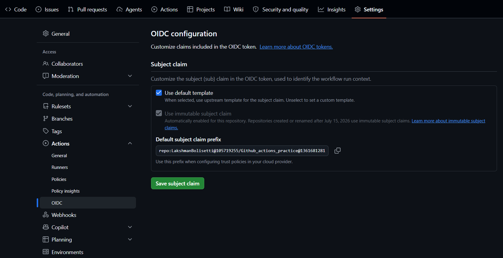
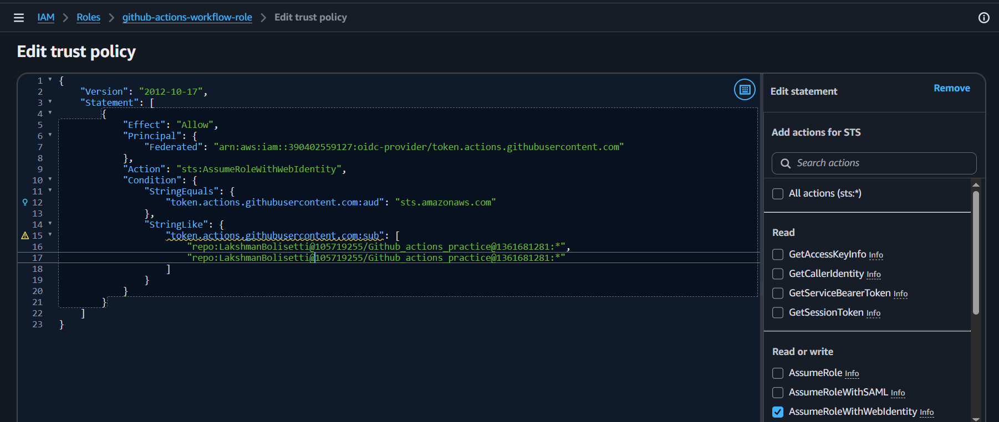

# How to Configure GitHub Actions OIDC with AWS

> A practical guide to configuring GitHub Actions OpenID Connect (OIDC) with AWS IAM, validating the connection with the AWS CLI, and allowing a workflow to deploy to Amazon EKS.
>
> **Source:** [DevOpsCube – How to Configure GitHub Actions OIDC with AWS (Easy Tutorial)](https://devopscube.com/github-actions-oidc-aws/)  
> **Authors:** Nitheesh Poojary and Bibin Wilson  
> **Published:** May 15, 2025  
> **Reading time shown on source page:** 9 minutes

This README preserves the technical topics, sequence, examples, and original diagrams/screenshots from the referenced article. Explanatory prose is rewritten for use as a standalone learning document; image links point to the original publisher-hosted assets.

---

## Table of contents

1. [Overview](#overview)
2. [Sample AWS deployment workflow](#sample-aws-deployment-workflow)
3. [AWS authentication methods for GitHub Actions](#aws-authentication-methods-for-github-actions)
   - [Access keys and secret keys](#1-access-keys-and-secret-keys)
   - [IAM roles for self-hosted runners](#2-iam-roles-for-self-hosted-runners)
   - [OpenID Connect](#3-openid-connect-a-more-secure-approach)
4. [Configure GitHub Actions OIDC with AWS IAM](#configure-github-actions-oidc-with-aws-iam)
   - [Step 1: Create the GitHub OIDC identity provider](#step-1-create-the-github-oidc-identity-provider-in-aws-iam)
   - [Step 2: Create a Web Identity IAM role](#step-2-create-a-web-identity-iam-role-with-a-trust-policy)
   - [Step 3: Add the role ARN to GitHub](#step-3-add-the-iam-role-arn-to-github)
   - [Step 4: Validate the OIDC connection](#step-4-test-the-oidc-connection-to-aws)
   - [Step 5: Grant GitHub Actions access to EKS](#step-5-enable-github-actions-access-to-amazon-eks-via-oidc)
   - [Step 6: Test the EKS workflow](#step-6-test-the-eks-workflow)
5. [End-to-end OIDC workflow](#end-to-end-oidc-workflow)
6. [OIDC with GitHub Enterprise Server](#configuring-oidc-for-aws-with-self-hosted-github-enterprise-server-ghes)
7. [Conclusion](#conclusion)
8. [Original article](#original-article)

---

## Overview

GitHub Actions workflows need an identity that AWS can authenticate before they can call AWS services. OIDC allows a workflow to obtain temporary AWS credentials without keeping long-lived AWS access keys in GitHub repository or organization secrets.

This guide covers:

- Why OIDC is preferable to long-lived AWS access keys for CI/CD.
- How GitHub's OIDC provider and AWS IAM work together.
- How to configure an IAM OIDC identity provider and an assumable IAM role.
- How to test the connection with AWS CLI.
- How to configure EKS access and deploy an example NGINX workload.

## Sample AWS deployment workflow

The example architecture uses GitHub Actions to authenticate to AWS, push container images to Amazon ECR, and deploy an application to Amazon EKS.


The diagram is an architectural example. The hands-on validation in this README first uses EC2 listing, then proceeds to EKS deployment.

## AWS authentication methods for GitHub Actions

A workflow must authenticate to AWS before it can access services such as EC2, ECR, or EKS. The common approaches are described below.

### 1. Access keys and secret keys

A traditional workflow can use an IAM user's access key and secret key:

```yaml
- name: Configure AWS credentials
  uses: aws-actions/configure-aws-credentials@v1
  with:
    aws-access-key-id: ${{ secrets.AWS_ACCESS_KEY_ID }}
    aws-secret-access-key: ${{ secrets.AWS_SECRET_ACCESS_KEY }}
    aws-region: us-west-2
```

This method stores long-lived credentials in GitHub Secrets. If those credentials are exposed, an attacker may be able to use them until they are revoked or otherwise invalidated. For that reason, long-lived credentials are not the preferred method for CI/CD authentication.

### 2. IAM roles for self-hosted runners

A self-hosted GitHub Actions runner hosted on AWS can use an IAM role attached to its underlying AWS compute resource (for example, through an instance profile).

Important distinction:

- This approach applies to self-hosted runners running in an AWS environment.
- It does not provide the same instance-role mechanism to GitHub-hosted public runners.

IAM roles provide temporary security credentials rather than requiring the workflow to store a permanent access key. Those credentials have a limited lifetime and stop being accepted after expiration.

### 3. OpenID Connect (a more secure approach)

With OIDC, a GitHub Actions workflow requests an OIDC token from GitHub and presents it to AWS. AWS validates the token and, if the configured trust conditions match, issues temporary credentials for the IAM role.

Key points:

- AWS access keys do not need to be stored as long-lived GitHub Secrets.
- Temporary credentials are issued when the workflow needs them.
- The credentials expire.
- OIDC can be used with GitHub-hosted and self-hosted runners.

OIDC adds an identity layer to OAuth 2.0. OAuth 2.0 is primarily an authorization framework, while OIDC provides authentication and identity information.

Useful references: [OpenID](https://openid.net/) and [OAuth 2.0](https://oauth.net/2/).

The remaining sections focus on GitHub Actions OIDC with AWS.

---

## Configure GitHub Actions OIDC with AWS IAM

The AWS-side identity provider and role are configured once. Individual workflows then assume that role when they run.

### Step 1: Create the OIDC identity provider in AWS IAM

GitHub is the OIDC identity provider in this integration. Add GitHub's provider information to AWS IAM.

1. Open the AWS Management Console.
2. Navigate to **IAM → Identity providers**.
3. Choose **Add provider**.
4. Enter the following values:

| Setting | Value |
|---|---|
| Provider type | OpenID Connect |
| Provider URL | `https://token.actions.githubusercontent.com` |
| Audience | `sts.amazonaws.com` |


This registers GitHub's OIDC issuer with AWS and establishes the provider side of the trust relationship.

### Step 2: Create a Web Identity IAM role with a trust policy

After creating the identity provider, assign an IAM role to it.

1. Open the newly created identity provider.
2. Choose **Assign role**.
3. Select the option to create a new role.
4. Choose **Web identity** as the trusted entity type.


A web identity role allows an identity outside AWS to use an OIDC token to request role credentials.


Enter the GitHub organization information in the role setup.


The trust configuration determines which GitHub identities are permitted to assume the role. Restrict it to the intended organization/repository/branch or other supported subject conditions; do not make the role assumable by unrelated repositories.

Next, attach the IAM permissions required by the workflow.


The source walkthrough uses administrator permissions for its demonstration. For a real environment, grant only the permissions required by the workflow.

Give the role a name, for example:

```text
github-actions-workflow-role
```

Get the identifiers needed for the trust policy

The AWS trust policy must match GitHub's OIDC `sub` (subject) claim.

Subject Claim Formats

**1. Immutable subject (repositories created after July 15, 2026):**
GitHub repositories created after **July 15, 2026** use immutable subject claims by default. The new subject contains both the owner ID and repository ID:

```text
repo:OWNER@OWNER_ID/REPOSITORY@REPOSITORY_ID:ref:refs/heads/main
```

**2. Traditional subject (older repositories):**

```text
repo:OWNER/REPOSITORY:ref:refs/heads/main
```

 Retrieve Owner ID and Repository ID




Review the role configuration and create it. This role defines what the GitHub Actions workflow is allowed to do in the AWS account.

### Step 3: Add the IAM role ARN to GitHub

The workflow needs the IAM role ARN so that the credentials action can request it.

The ARN can be stored as either:

- **Organization secret:** available to repositories permitted by the organization's secret policy.
- **Repository secret:** available only to the selected repository.

For the example, the article uses an organization-level secret.

1. Open the GitHub organization or repository settings.
2. Go to **Secrets and variables → Actions**.
3. Create a secret with this name:

```text
AWS_OIDC_ROLE
```

4. Set its value to the ARN of the IAM role created in Step 2.


The secret contains the role ARN, not an AWS access key or secret key.

### Step 4: Test the OIDC connection to AWS

Before configuring EKS, validate that GitHub Actions can assume the AWS role and call an AWS API.

The credentials action is `aws-actions/configure-aws-credentials`. It uses the GitHub OIDC token and assumes the role whose ARN is stored in `AWS_OIDC_ROLE`.

The core step is:

```yaml
- name: Configure AWS credentials using OIDC
  uses: aws-actions/configure-aws-credentials@v4
  with:
    role-to-assume: ${{ secrets.AWS_OIDC_ROLE }}
    aws-region: us-west-2
```

Create the workflow file `.github/workflows/ec2-list.yaml` in your repository:

```yaml
name: List EC2 Instances

on:
  push:
    branches:
      - main

permissions:
  id-token: write
  contents: read

jobs:
  list-ec2:
    runs-on: ubuntu-latest

    steps:
      - name: Checkout repository
        uses: actions/checkout@v3

      - name: Configure AWS credentials using OIDC
        uses: aws-actions/configure-aws-credentials@v4
        with:
          role-to-assume: ${{ secrets.AWS_OIDC_ROLE }}
          aws-region: us-west-2

      - name: List EC2 Instances
        run: |
          aws ec2 describe-instances \
            --query "Reservations[*].Instances[*].InstanceId" \
            --output table
```

Commit and push the workflow to the `main` branch to trigger it.

If the provider, role trust relationship, GitHub secret, and IAM permissions are configured correctly, the workflow should authenticate and print the EC2 instance IDs.


**Validation checkpoint:** Do not proceed to EKS until this workflow successfully assumes the role and runs the EC2 API command. If the AWS CLI command returns an authorization error, verify that the role has the required EC2 read permission.

### Step 5: Enable GitHub Actions access to Amazon EKS via OIDC

EKS access involves two separate authorization layers:

1. **AWS IAM:** the GitHub workflow must assume the IAM role and have permission to interact with the EKS cluster.
2. **Kubernetes/EKS cluster access:** the IAM role must be granted access to Kubernetes resources through the cluster's access configuration and associated access policy.

First, make sure the AWS CLI is up to date and supports the EKS access-entry commands.

Create an EKS access entry for the IAM role:

```bash
aws eks create-access-entry \
    --cluster-name <your-cluster-name> \
    --principal-arn <your-role-arn-here> \
    --kubernetes-groups github-runners \
    --type STANDARD \
    --username github-actions-oidc
```

Replace the placeholders with your EKS cluster name and IAM role ARN.

List the EKS access policies:

```bash
aws eks list-access-policies --output table
```

The source walkthrough discusses using an EKS administrative policy for cluster management, while the command shown in the article associates the view policy. The exact command shown there is reproduced below:

```bash
aws eks associate-access-policy \
  --cluster-name <your-cluster-name> \
  --principal-arn <your-role-arn-here> \
  --policy-arn arn:aws:eks::aws:cluster-access-policy/AmazonEKSViewPolicy \
  --access-scope type=cluster
```

**Important:** `AmazonEKSViewPolicy` is a view/read-oriented policy, not an administrative deployment policy. For a deployment workflow, choose an access policy and scope that provide the minimum permissions the workflow needs. Do not grant cluster-admin access merely to make a test pass.

### Step 6: Test the EKS workflow

The authentication and deployment sequence is:

1. GitHub Actions requests an OIDC token from GitHub.
2. The workflow presents the token to AWS STS using `AssumeRoleWithWebIdentity`.
3. AWS validates the token against the configured OIDC provider and role trust policy.
4. AWS issues temporary credentials for the IAM role.
5. The workflow uses those credentials to access AWS and configure EKS access.


The following example uses `workflow_dispatch`, allowing you to start the deployment manually from the GitHub Actions page.

Create `.github/workflows/deploy-nginx-eks.yaml`:

```yaml
name: Deploy NGINX to EKS

on:
  workflow_dispatch:

permissions:
  id-token: write
  contents: read

jobs:
  deploy:
    runs-on: ubuntu-latest

    steps:
      - name: Checkout repository
        uses: actions/checkout@v3

      - name: Configure AWS credentials using OIDC
        uses: aws-actions/configure-aws-credentials@v4
        with:
          role-to-assume: ${{ secrets.AWS_OIDC_ROLE }}
          aws-region: us-west-2

      - name: Set up kubeconfig
        run: |
          aws eks update-kubeconfig --region us-west-2 --name eks-spot-cluster-bibin

      - name: Deploy NGINX to EKS
        run: |
          kubectl create deployment nginx --image=nginx --port=80 --dry-run=client -o yaml | kubectl apply -f -
```

Before running the workflow, update:

- `AWS_OIDC_ROLE` so it points to the correct IAM role ARN.
- `us-west-2` if your EKS cluster is in another AWS region.
- `eks-spot-cluster-bibin` to your actual EKS cluster name.

Also ensure that the runner has a compatible `kubectl` binary available. The IAM role must be authorized in the EKS cluster, and its EKS access policy must permit the deployment operation.

Run the workflow manually from **GitHub → Actions → Deploy NGINX to EKS → Run workflow**.


---

## End-to-end OIDC workflow

The following diagram shows the overall GitHub Actions-to-AWS OIDC exchange.


The process can be understood as follows:

1. **One-time AWS setup:** create the GitHub OIDC identity provider in IAM and create an IAM role with a trust policy that permits the intended GitHub workflow identity.
2. **Request an identity token:** `aws-actions/configure-aws-credentials` requests a JWT from GitHub's OIDC provider.
3. **Exchange the token:** the action sends the token to AWS Security Token Service (STS).
4. **Validate the identity:** AWS checks the token and its claims against the configured identity provider and IAM role trust policy.
5. **Issue temporary credentials:** after successful validation, STS returns temporary AWS credentials. The source article describes a default session duration of one hour and a configurable range of 15 minutes to 12 hours, subject to role and action configuration.
6. **Expose credentials to the job:** the credentials action makes the temporary credentials available to subsequent workflow steps, including through environment variables such as:
   - `AWS_ACCESS_KEY_ID`
   - `AWS_SECRET_ACCESS_KEY`
   - `AWS_SESSION_TOKEN`
7. **Call AWS services:** AWS CLI commands and SDKs (for example, Boto3) use the credentials to call AWS APIs.

### What if the workflow finishes before the credentials expire?

Temporary credentials remain valid until their expiration or revocation conditions apply. For example, if a job finishes after 10 minutes but received credentials valid for one hour, those credentials may remain technically valid for the rest of that session duration. The runner ending does not, by itself, mean the credentials have immediately expired.

---

## Configuring OIDC for AWS with self-hosted GitHub Enterprise Server (GHES)

OIDC can also be configured with a self-hosted GitHub Enterprise Server instance. The issuer URL differs from GitHub.com.

For GHES, the issuer URL follows this form:

```text
https://<GHES_HOSTNAME>/_services/token
```

Important considerations:

- Use the GHES hostname as the issuer URL.
- The GHES OIDC endpoint must be reachable by AWS over HTTPS, or otherwise be accessible in a way that permits AWS to retrieve the issuer metadata and keys.
- A fully private GHES instance that AWS cannot reach cannot be used for this AWS OIDC setup, because AWS must retrieve the OIDC issuer metadata.

---

## Conclusion

GitHub Actions OIDC provides a way to authenticate to AWS without keeping long-lived AWS access keys in GitHub Secrets. The workflow receives temporary credentials only after AWS validates the GitHub-issued identity token and the IAM role trust policy.

The practical sequence in this guide is:

1. Register GitHub as an OIDC identity provider in AWS IAM.
2. Create a Web Identity IAM role and restrict its trust policy.
3. Save the role ARN in GitHub as `AWS_OIDC_ROLE`.
4. Validate the integration with a simple AWS CLI command that lists EC2 instances.
5. Configure EKS access for the IAM role.
6. Run a GitHub Actions workflow to deploy NGINX to EKS.

Use least-privilege IAM permissions and EKS access policies in production. Review the role's trust conditions regularly so that only the intended repositories and workflows can assume it.

## Original article

[How to Configure GitHub Actions OIDC with AWS (Easy Tutorial) – DevOpsCube](https://devopscube.com/github-actions-oidc-aws/)

**Authors:** Nitheesh Poojary and Bibin Wilson  
**Original publication date:** May 15, 2025
